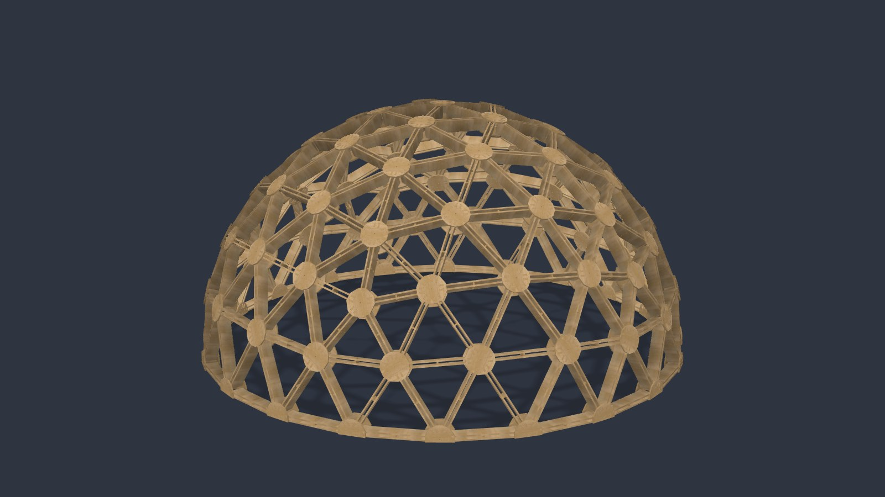
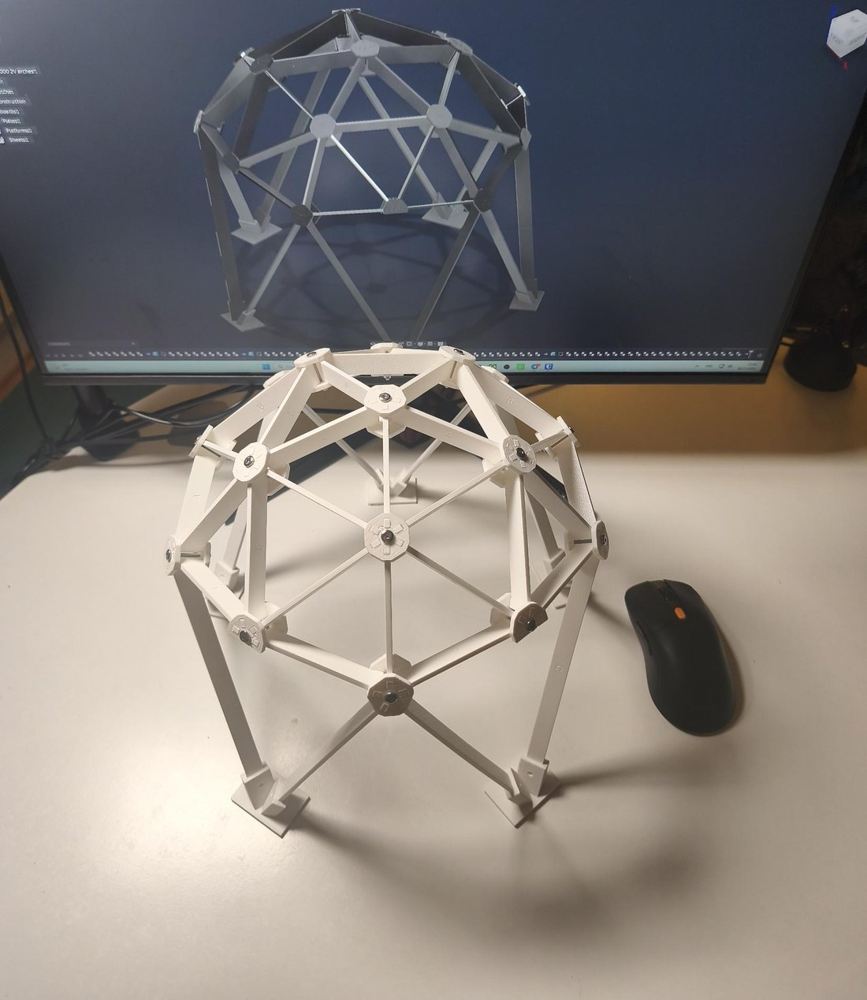
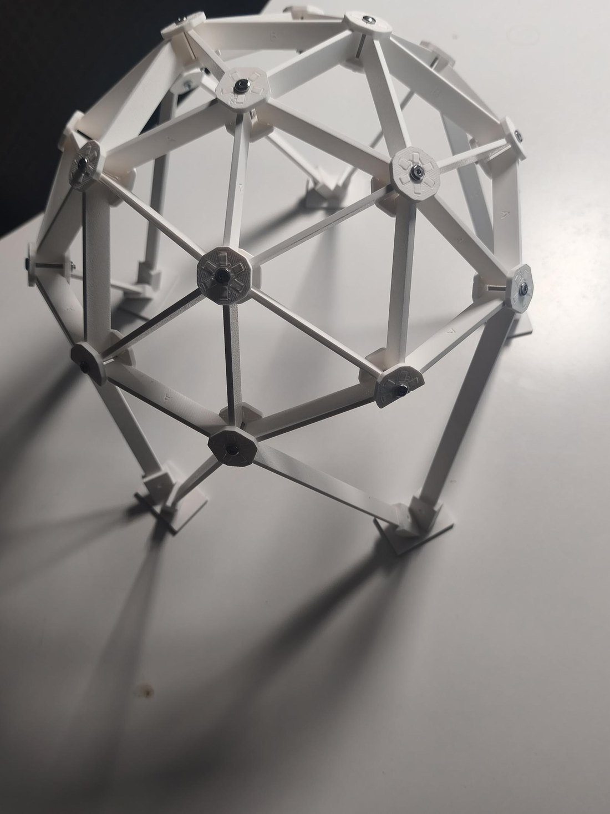
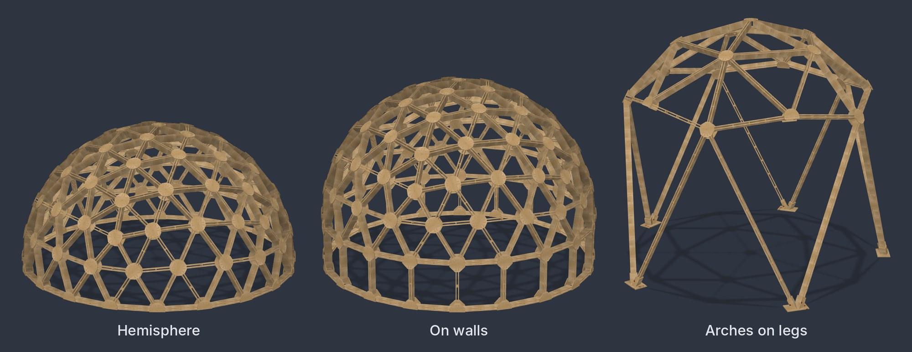
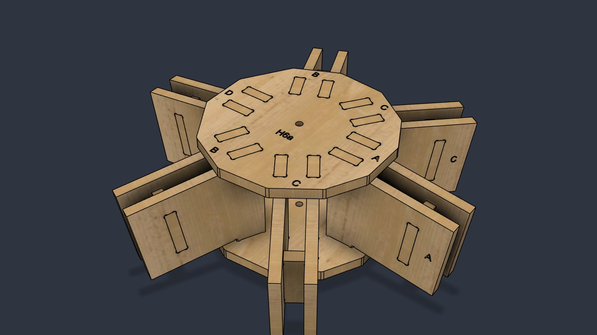
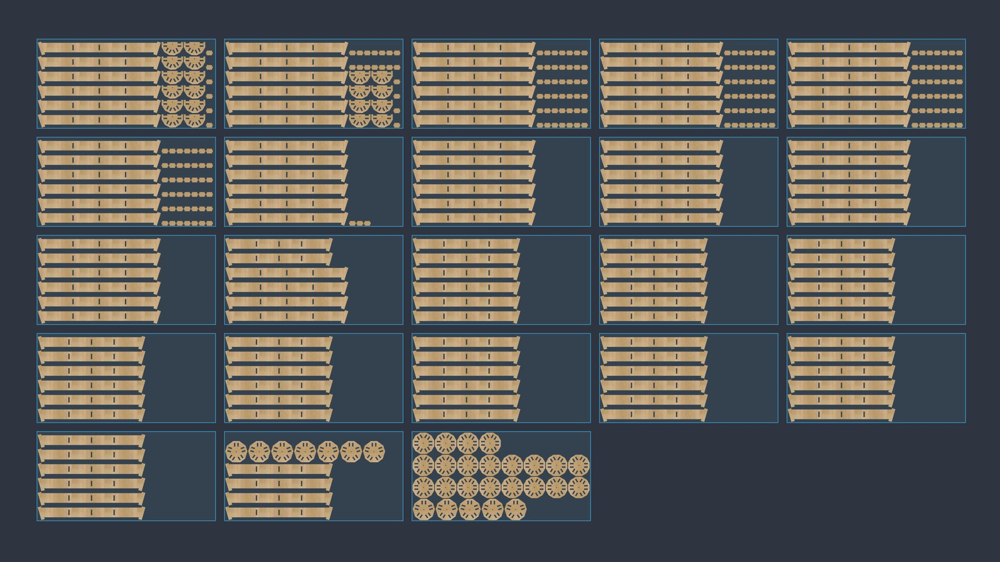
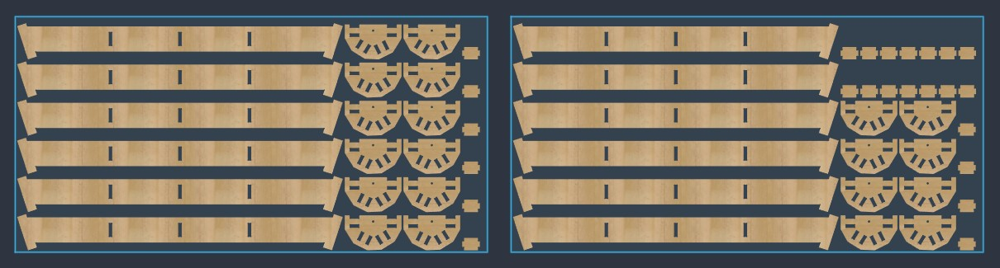
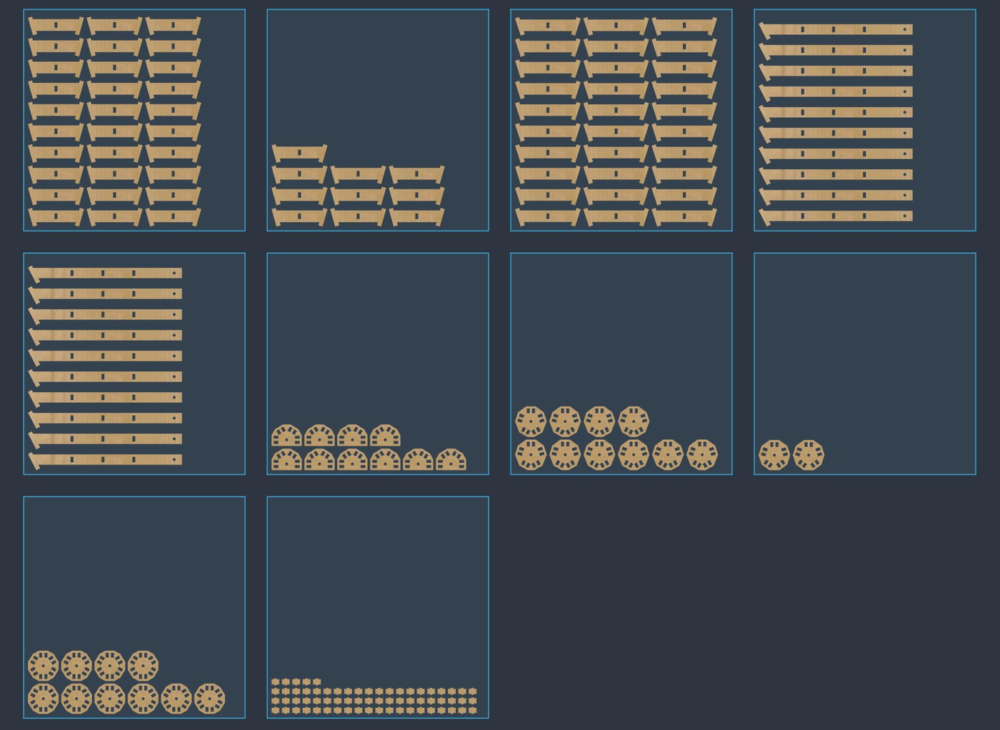

# 🚀 Rocket Geodome

**Geodesic dome frames from CNC plywood, designed in Autodesk Fusion in a few clicks.**

Pick a size, press Build, and get a complete dome: every board, hub plate and spacer as a real 3D part, labelled, with dogbones, laid out on sheets and exported to DXF for your CNC router.

Free for personal use. Made by a camper van builder and CNC designer from Bavaria.

**English** · [Русский](README.ru.md)

https://github.com/user-attachments/assets/7539f1a9-004f-4d98-9b45-132536a98b58

---

## Why Rocket Geodome

- **Real parts, not a wireframe.** Every board, plate and spacer is a separate solid you can mill, print or send to a CNC shop.
- **Proven on a physical model.** I printed a 1:10 model straight from the plugin's own parts and bolted it together. Every piece fit the first time.
- **Made by a CNC designer for CNC work.** Dogbones sized for your cutter, clearance per side, engraved labels, boards laid along the grain.
- **Easy to assemble.** Every part carries its type, and every slot shows the letter of the board that goes in.
- **Free.** No trial, no locked features. If it saves you time, you can [buy me a coffee ☕](https://ko-fi.com/sashavmire).

### From the screen to a real dome

  
  

<em>A 3 m dome on arches, printed at 1:10 from the parts the plugin generated and bolted together with M3 screws.</em>

---

## Features

- **Geodesic hemispheres:** 2V, 4V and 6V.
- **Three base shapes:** plain hemisphere, hemisphere on straight walls, and an arched pavilion on five legs.
- **CNC-ready construction:** single or twin-board struts with spacers, sandwich hubs on tenons, one M12 bolt per hub.
- **One hub radius for the whole dome:** fewer part types, simpler cutting and assembly.
- **Machining details built in:** dogbones, clearance per side, hub plates as hull or circle with rounded corners.
- **Assembly labels:** type letters and codes engraved on every part, plus the matching board letter at every slot.
- **Sheet layout and DXF export:** the dome's parts are laid out on your sheet size, one DXF per sheet, in millimetres.
- **Model scale 1:N:** a printable version of the same dome with its own print values, plus STL export per part type.
- **Test hub mode:** cut one hub with short strut stubs and check the fit before cutting the whole dome.
- **Live results:** part counts and types, plywood area, estimated frame weight and warnings while you type.
- **Bill of materials (BOM)** with parts and fasteners, saved as CSV.
- **Presets:** start from ready-made domes or save your own.
- **Edit later:** select a built dome and run the command again to change its parameters.
- **English and Russian interface** with a tooltip on every field. English by default, switch at the top of the dialog.
- Works with both Z-up and Y-up Fusion settings.

---

## Base shapes

| Shape | Description |
|---|---|
| **Hemisphere** | The dome stands right on the floor. |
| **On walls** | Straight walls of posts and rings under the equator lift the dome by the wall height. |
| **Arches on legs** | Five long V-shaped legs under the dome with five pointed arch openings between them, like an open pavilion. Each leg stands on its own foot platform. |

---

## How the dome is built

Rocket Geodome uses a construction system designed for flat CNC parts:

| Part | What it is |
|---|---|
| **Strut** | One board or two parallel boards between two hubs. Each strut lies in one plane with both hub axes, so its boards are flat and straight. |
| **Spacer** | A small part between the twin boards of a strut. It holds the gap and stiffens the strut. In a house the gap is filled with insulation. |
| **Hub** | Two plywood plates, outer and inner. The tenons at the board ends sit square in their slots and come out flush with the plate face. |
| **Fasteners** | Per hub: one M12 bolt through the center, a nut, two washers and a sleeve. They are listed in the BOM. |

The geometry starts from an icosahedron. Each edge is split into 2, 4 or 6 pieces (the **frequency**), projected onto a sphere and cut to a hemisphere.

One hub radius is used across the whole dome. That keeps the number of board types low: a plain hemisphere has just **2 board types at 2V, 6 at 4V and 9 at 6V**. The pentagon plates come out only slightly larger.

**Labels.** Every part is engraved with its type:

- boards get a letter, **A, B, C …** from short to long, in the middle of the board;
- plates get a code like **H5a** or **H6b** (H, the number of struts in the hub, a letter);
- spacers are **S**, one type for the whole dome;
- next to every slot on a plate is the letter of the board that goes in.

Labels are cut 0.5 mm deep and sized for a 60° V-bit. Assembly comes down to matching letters.

**How many parts?** For a 6 m hemisphere with twin-board struts:

| Frequency | Boards | Plates | Spacers | Total |
|---|---|---|---|---|
| 2V | 130 | 52 | 195 | 377 |
| 4V | 500 | 182 | 250 | 932 |
| 6V | 1110 | 392 | 555 | 2057 |

---

## Sheet layout and DXF export

After building, Rocket Geodome can lay the flat parts of the dome (boards, plates, spacers) out on sheets next to the dome:

- rows along the long side of the sheet;
- parts turned only 0° or 90°, boards along the grain;
- your sheet size, edge margin and part spacing;
- **one DXF per sheet**, in millimetres, ready for your CAM.

A 6 m 2V dome, for example, fits on 23 sheets of 2440 × 1220 mm. Only the dome's own parts are used. Other bodies in your project are ignored.

The layout is intentionally simple: it aims to be correct and easy to check, not to squeeze out every square centimetre. Tighter nesting for any project is coming in **Rocket Nesting** (coming soon).

---

## Model scale 1:N (3D printing)

Want to see your dome before cutting a single sheet? Set a model scale, for example 1:10:

- the same dome, scaled down: diameter, frame depth, gaps, spacer spacing, tenons, webs and plate margins are divided by N;
- print values are set separately in the **Model** group: part thickness, clearance, bolt hole, label height and print bed;
- no dogbones, and labels by type only;
- a small printed **tube** (sleeve) for every hub;
- every part is checked against your print bed and can be turned 90° to fit;
- **STL export per part type**: each file lies flat, labels up, with the quantity in the file name, for example `Plate H6a x20.stl`;
- the BOM lists M3 bolts and grams of PLA instead of plywood.

What the model presets give you:

- **3 m 2V model 1:10:** a 300 mm dome with 273 parts (130 boards, 52 plates, 65 spacers, 26 tubes), up to about 612 g of PLA printed solid, held together with 26 M3 × 30 bolts.
- **3 m 2V arches model 1:10:** the model in the photos above. Its parts fit on ten 256 × 256 mm beds, about 600 g of PLA. The legs plug into five printed foot platforms and are held with M3 × 25 threaded rods.

---

## Requirements

- Autodesk Fusion on Windows or macOS.
- A CNC router for full-size parts (your own or a local CNC shop), or a 3D printer for a model.

---

## Installation

1. Download the latest `RocketGeodome-x.x.x.zip` from [**Releases**](../../releases/latest).
2. Unzip it. Inside is a folder called `RocketGeodome`.
3. Move that folder into your Fusion add-ins folder:
   - **Windows:** `%APPDATA%\Autodesk\Autodesk Fusion 360\API\AddIns`
   - **macOS:** `~/Library/Application Support/Autodesk/Autodesk Fusion 360/API/AddIns`
4. In Fusion open **Utilities → Add-Ins** (`Shift + S`), find **Rocket Geodome** in the list and click **Run**. Turn on **Run on Startup** so it loads every time.
5. The Rocket Geodome button appears in the **Design** workspace under **Solid → Create**.

> **Tip:** instead of copying the folder, you can also click **+** in the Add-Ins dialog and pick the unzipped `RocketGeodome` folder.

---

## Your first dome in five minutes

1. Click the **Rocket Geodome** button.
2. Read the **Important** block at the top of the dialog and tick **I understand**. You only need to tick it once.
3. Pick a preset, for example **6 m 4V tent**, or set **Diameter** and **Frequency** yourself.
4. Watch the wireframe preview and the **Results** group update as you change values.
5. Set **Build mode** to **Full dome**. For cutting files, also tick **Sheet layout** and **Export DXF**.
6. Click **Build**. If you export files, pick a folder for them.

> A 2V dome builds in seconds. A 4V or 6V dome has hundreds or thousands of parts, so give Fusion a few minutes.

---

## Build modes

| Mode | What you get |
|---|---|
| **Full dome** | The complete frame. One component per part type and an occurrence at every place, a floor sketch and a BOM CSV. Every part moves on its own. |
| **Skeleton** | A fast wireframe sketch of the dome to check size and proportions. |
| **Test hub** | One hub with short strut stubs, for a trial cut on your machine before you commit to the whole dome. |

---

## Parameters

All lengths are in millimetres. Every field has a tooltip in the plugin, and labels can differ slightly between versions.

**Shape**

| Parameter | Default | Meaning |
|---|---|---|
| Diameter | 6000 | Outer diameter of the node sphere. |
| Frequency | 4V | How many pieces each icosahedron edge is split into. Higher means more but shorter parts and a rounder dome. |
| Base shape | Hemisphere | Hemisphere, on walls, or arches on legs. |
| Wall height | 1000 | On walls only. From the floor to the middle of the dome's lowest ring, the equator. |
| Leg length | 0 = auto | Arches only. Length of the long side of each V leg. |

**Struts**

| Parameter | Default | Meaning |
|---|---|---|
| Frame depth | 150 | Radial depth of the frame, i.e. the board height. |
| Boards per strut | 2 | 1: a single board. 2: twin boards with a gap and spacers between them. |
| Plywood thickness | 18 | Plywood for boards and spacers. Enter the real thickness measured with calipers: the slots are sized from it. |
| Board gap | 30 | Distance between the twin boards, held by the spacers. |
| Max spacer spacing | 400 | Largest distance between spacers along a strut. They are spread evenly, at least one per strut. |
| Spacer inset | 20 | How far the spacer stays in from the outer and inner edges of the board. |

**Hubs**

| Parameter | Default | Meaning |
|---|---|---|
| Plate thickness | 18 | Plywood of the hub plates. The board tenons come out flush with the plate face. |
| Tenon length | 50 | Tenon length along the strut: how far the board reaches under the plate. |
| Min web | 10 | Least plywood left between neighbouring slots. It sets where the boards start, i.e. the hub radius. |
| Plate margin | 25 | Plywood left between the slots and the plate edge. |
| Plate shape | Hull | Hull: an outline along the slots with rounded corners, uses less plywood. Circle: a round plate. |
| Corner radius | 10 | Rounding of the plate corners. |
| Center hole | 12 | Bolt hole. 12 mm for an M12 bolt hammered in. |

**CNC**

| Parameter | Default | Meaning |
|---|---|---|
| Clearance per side | 0.2 | Extra space per side in every slot. |
| Dogbone diameter | 8.2 | Your cutter diameter plus 0.2. The default is for an 8 mm cutter. |
| Sheet length × width | 2440 × 1220 | Your sheet size, for the fit check and the sheet layout. |
| Margin, spacing | — | Distance to the sheet edge and between parts in the layout. |
| Labels, label height | on, 12 | Engraved type labels on every part. |

**Model** (only for model scale 1:N)

| Parameter | Default | Meaning |
|---|---|---|
| Model scale | off | N in 1:N. The shape is scaled down, the print values below are set separately. |
| Print thickness | 3 | Thickness of the printed boards and plates. |
| Print clearance | 0.2 | Clearance per side for printing. |
| Print hole | 3.3 | Bolt hole, for M3. |
| Print label height | 5 | Height of the printed labels. |
| Print bed | 256 × 256 | Bed size for the layout and the fit check. |

---

## Presets

The plugin ships with these presets:

- **6 m 4V tent**
- **6 m 2V arches**
- **8 m 4V arches pavilion**
- **6 m 4V on walls 1 m**
- **3 m 2V model 1:10**
- **3 m 2V arches model 1:10**

Save your own: type a name in **Save as** and tick **Save preset**. The last used parameters are remembered automatically.

To change a dome you already built, select it and click the Rocket Geodome button again. Its parameters are stored in the dome itself.

---

## Output files

| Output | Use |
|---|---|
| Fusion components | One component per part type, an occurrence at every place. Every part moves on its own. |
| Floor sketch | Footprint of the dome for laying out the base. |
| BOM (CSV) | All part types and fasteners with quantities, for cutting and ordering. |
| DXF per sheet | Cutting files for your CAM or a CNC shop. |
| STL per part type | For printing a model: flat, labels up, quantity in the file name. |

---

## Tips from the workshop

- **Cut a test hub first.** It costs a few minutes and saves a whole sheet if your clearance is off. For a model, print one test hub first to check the clearance on your printer.
- **Measure your plywood.** "18 mm" plywood is rarely exactly 18 mm. Enter the real value.
- **Match the dogbone to your cutter.** Cutter diameter plus 0.2 mm works well.
- **Hammer the M12 bolt in.** A 12 mm hole gives a tighter, stiffer hub than 13 mm.
- **Watch the warnings.** On large domes and long legs some boards can be longer than your sheet. The plugin warns you. Such parts need glued laminated timber or a proper splice, which is not included in v1.0.
- **Small models:** if the printed labels are hard to read, raise the print label height.

---

## ⚠️ Disclaimer

Rocket Geodome is a free design tool, provided **as is, without any warranty**.

It generates geometry. It does **not** do structural engineering. The author takes no responsibility for the strength, stability or safety of anything built with it.

Before you build anything people will stand under or sleep in:

- check snow and wind loads for your location;
- choose materials and fasteners suitable for structural and outdoor use;
- follow your local building regulations and permit rules;
- have the design checked by a qualified engineer.

You build at your own risk.

---

## License

Rocket Geodome is licensed under the **[PolyForm Noncommercial License 1.0.0](LICENSE.md)**.

In short (the full text in [`LICENSE.md`](LICENSE.md) is what applies):

**You may:**
- use it for free for personal, hobby, educational and other noncommercial purposes;
- build your own dome with it;
- read the code, learn from it and change it for yourself.

**You may not without permission:**
- sell the plugin or a modified copy of it;
- use it to sell domes, kits, cutting services or design services.

**Commercial license:** for CNC shops, builders and companies. Message me on [Instagram](https://www.instagram.com/sashavmire/) or [Telegram](https://t.me/fusion2van).

The same license, with a short summary in English and Russian, is included as `LICENSE.txt` in the add-in folder.

Required Notice: Copyright (c) 2026 Alexander (https://www.instagram.com/sashavmire/)

Autodesk and Fusion are trademarks of Autodesk, Inc. This project is not affiliated with Autodesk.

---

## Support ☕

Rocket Geodome is free, and it will stay free. If it saved you time or money:

- [**Support me on Ko-fi**](https://ko-fi.com/sashavmire). Every coffee goes into new versions and new tools.
- Give the repository a ⭐ so more builders can find it.
- Share it with someone who dreams of a dome.

---

## Show your dome 🌍

I would love to see what you build. Every photo makes my day.

- Tag **[@sashavmire](https://www.instagram.com/sashavmire/)** on Instagram with **#RocketGeodome**
- Or post it in the Telegram channel **[t.me/fusion2van](https://t.me/fusion2van)**

Printed models, test hubs and full-size domes are all welcome.

---

## Roadmap

- Fixes and improvements from your feedback
- Splicing for struts longer than a sheet
- More frequencies and dome variants
- Autodesk App Store release
- **Rocket Nesting:** tight nesting for any project (coming soon)

Found a bug or have an idea? Open an [issue](../../issues).

---

## Changelog

**v1.0.0** (November 2026): first public release.

---

Made with ❤️ in Bavaria by **Alexander** · [Instagram](https://www.instagram.com/sashavmire/) · [Telegram](https://t.me/fusion2van) · [Ko-fi](https://ko-fi.com/sashavmire)

