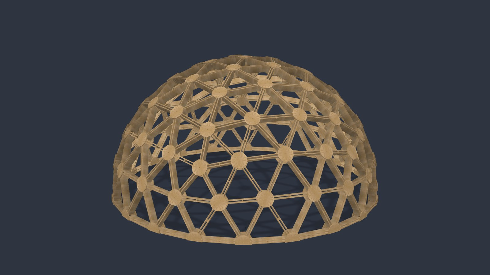
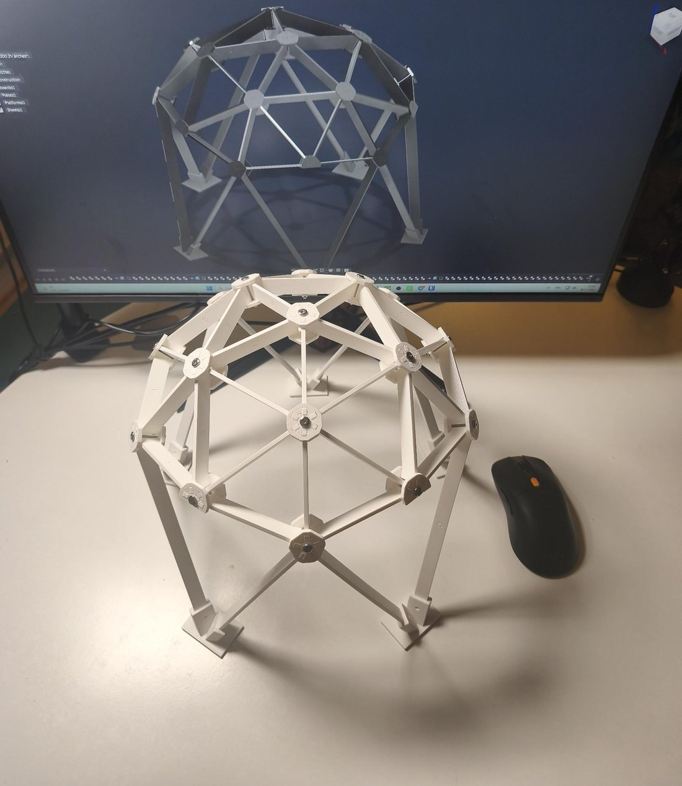
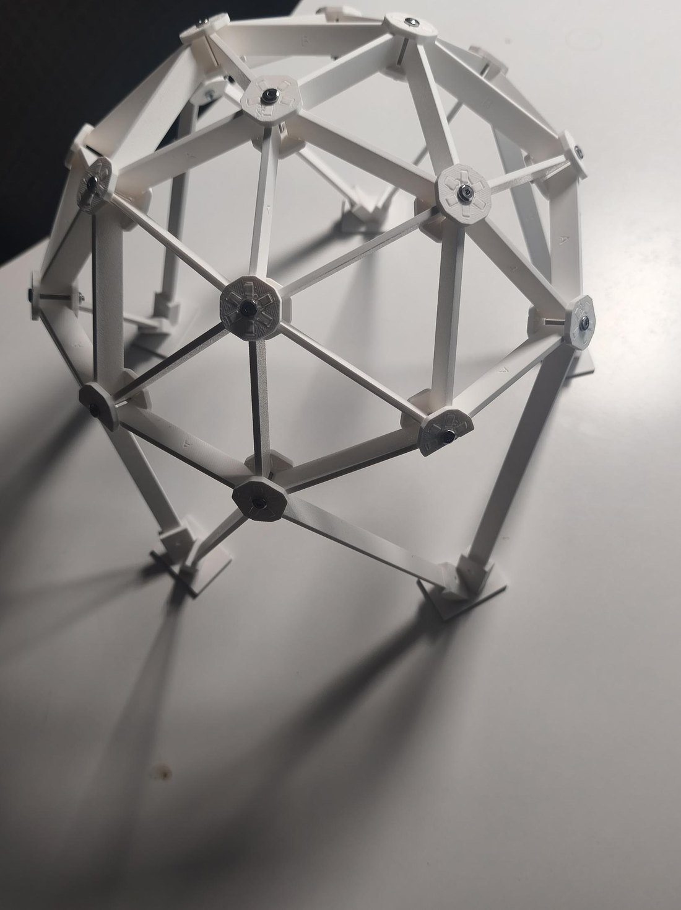
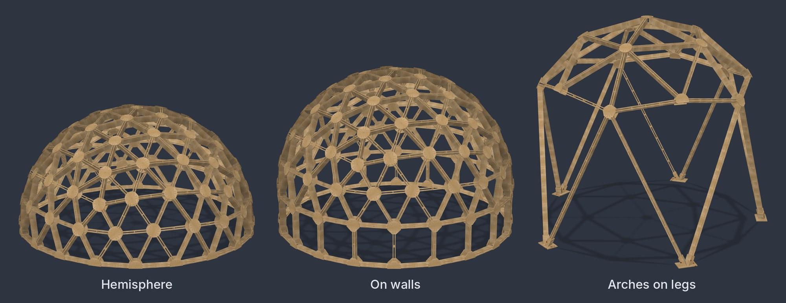
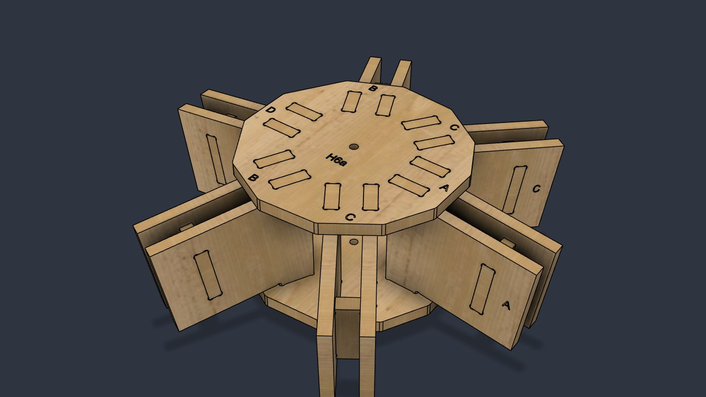
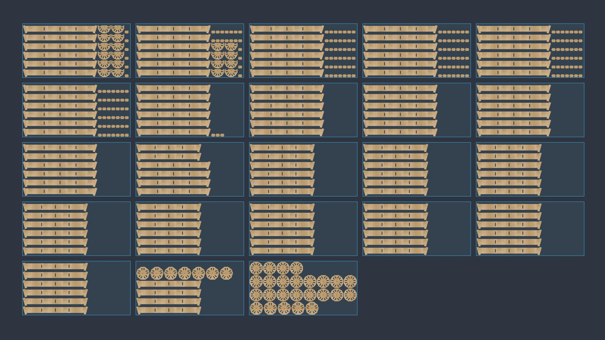
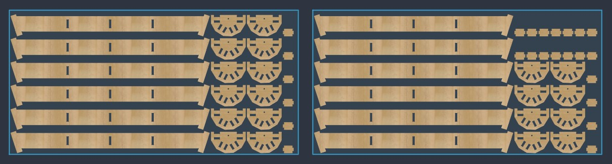
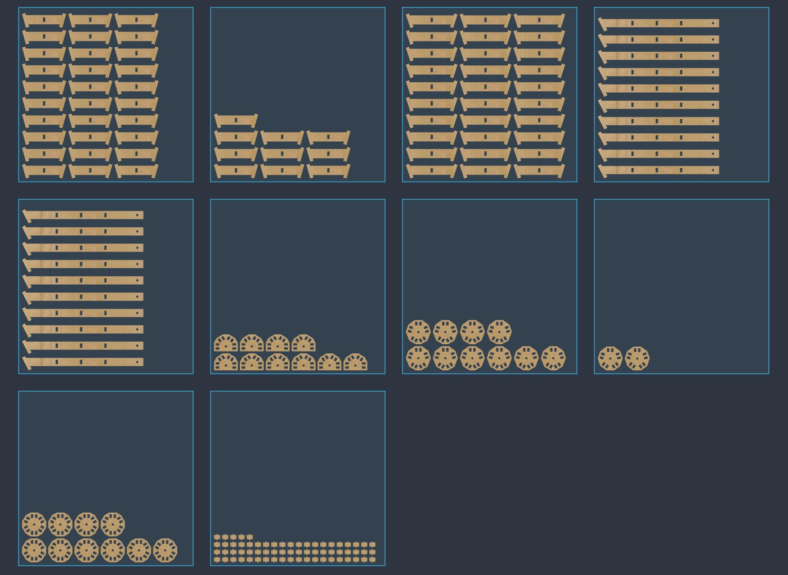

# 🚀 Rocket Geodome

**Каркасы геодезических куполов из фанеры под ЧПУ — в Autodesk Fusion за пару кликов.**

Выбираешь размер, жмёшь «Построить» и получаешь готовый купол: каждая доска, пластина узла и проставка — настоящая 3D-деталь с маркировкой и dogbones, разложенная на листы и выгруженная в DXF для твоего ЧПУ.

Бесплатно для личного использования. Сделал строитель кемперов и конструктор ЧПУ-мебели из Баварии.

[English](README.md) · **Русский**

https://github.com/user-attachments/assets/7539f1a9-004f-4d98-9b45-132536a98b58

---

## Почему Rocket Geodome

- **Настоящие детали, а не каркас из линий.** Каждая доска, пластина и проставка — отдельное тело, которое можно фрезеровать, печатать или отдать в ЧПУ-цех.
- **Проверено на модели.** Я напечатал модель 1:10 прямо из деталей плагина и собрал на болтах. Всё встало с первого раза.
- **Сделано конструктором ЧПУ для ЧПУ.** Dogbones под твою фрезу, зазор на сторону, гравировка маркировки, доски вдоль волокон.
- **Легко собирать.** На каждой детали её тип, а у каждого паза — буква доски, которая туда входит.
- **Бесплатно.** Без пробного периода и закрытых функций. Если плагин сэкономил тебе время, можешь [угостить меня кофе ☕](https://ko-fi.com/sashavmire).

### С экрана — в настоящий купол

  
  

<em>Купол 3 м на арках: напечатан в масштабе 1:10 из деталей, которые сделал плагин, и собран на винтах M3.</em>

---

## Возможности

- **Геодезические полусферы:** 2V, 4V и 6V.
- **Три основания:** обычная полусфера, полусфера на прямых стенах и павильон на пяти арках-ногах.
- **Конструкция под ЧПУ:** рёбра из одной или двух досок с проставками, узлы-«бутерброды» на шипах, один болт M12 на узел.
- **Один радиус узла на весь купол:** меньше типов деталей, проще резать и собирать.
- **Всё для фрезеровки уже внутри:** dogbones, зазор на сторону, пластины узлов многоугольником или кругом со скруглёнными углами.
- **Маркировка для сборки:** буквы и коды типов гравируются на каждой детали, плюс буква нужной доски у каждого паза.
- **Раскладка на листы и экспорт DXF:** детали купола раскладываются на лист твоего размера, по одному DXF на лист, в миллиметрах.
- **Масштаб модели 1:N:** тот же купол для 3D-печати со своими параметрами печати и экспортом STL по типам деталей.
- **Режим «Пробный узел»:** вырежи один узел с короткими обрезками досок и проверь посадку, прежде чем резать весь купол.
- **Результаты на лету:** число деталей и типов, площадь фанеры, примерный вес каркаса и предупреждения — прямо пока вводишь значения.
- **Спецификация (BOM)** с деталями и крепежом, сохраняется в CSV.
- **Пресеты:** начни с готового купола или сохрани свой.
- **Правка потом:** выдели построенный купол, запусти команду снова и поменяй параметры.
- **Интерфейс на английском и русском**, подсказка у каждого поля. По умолчанию английский, язык переключается вверху окна.
- Работает с ориентацией Fusion и Z вверх, и Y вверх.

---

## Основания

| Основание | Описание |
|---|---|
| **Полусфера** | Купол стоит прямо на полу. |
| **На стенах** | Прямые стены из стоек и колец под экватором поднимают купол на высоту стен. |
| **Арки на ногах** | Пять длинных ног-«V» под куполом и пять стрельчатых арок-проходов между ними, как открытый павильон. Каждая нога стоит на своей опорной платформе. |

---

## Как устроен купол

Rocket Geodome использует конструкцию, придуманную под плоские детали для ЧПУ:

| Деталь | Что это |
|---|---|
| **Ребро** | Одна или две параллельные доски между двумя узлами. Каждое ребро лежит в одной плоскости с осями обоих узлов, поэтому доски плоские и прямые. |
| **Проставка** | Небольшая деталь между двумя досками ребра. Держит зазор и делает ребро жёстким. В доме этот зазор заполняется утеплителем. |
| **Узел** | Две фанерные пластины, наружная и внутренняя. Шипы на концах досок встают в пазы ровно и выходят заподлицо с наружной гранью пластины. |
| **Крепёж** | На узел: один болт M12 через центр, гайка, две шайбы и втулка. Всё есть в спецификации. |

Геометрия строится от икосаэдра. Каждое ребро делится на 2, 4 или 6 частей (это **частота**), проецируется на сферу и обрезается до полусферы.

На весь купол один радиус узла. Поэтому типов досок мало: у обычной полусферы всего **2 типа при 2V, 6 при 4V и 9 при 6V**. Пятиугольные пластины выходят лишь чуть больше.

**Маркировка.** На каждой детали гравируется её тип:

- доски получают букву **A, B, C …** от короткой к длинной, посередине доски;
- пластины — код вроде **H5a** или **H6b** (H, число рёбер в узле, буква);
- проставки — **S**, один тип на весь купол;
- у каждого паза на пластине стоит буква доски, которая туда входит.

Гравировка глубиной 0,5 мм, под V-фрезу 60°. Сборка сводится к совпадению букв.

**Сколько деталей?** Для полусферы 6 м с рёбрами из двух досок:

| Частота | Доски | Пластины | Проставки | Всего |
|---|---|---|---|---|
| 2V | 130 | 52 | 195 | 377 |
| 4V | 500 | 182 | 250 | 932 |
| 6V | 1110 | 392 | 555 | 2057 |

---

## Раскладка на листы и экспорт DXF

После сборки Rocket Geodome может разложить плоские детали купола (доски, пластины, проставки) на листы рядом с куполом:

- рядами вдоль длинной стороны листа;
- поворот только на 0° или 90°, доски вдоль волокон;
- твой размер листа, отступ от края и расстояние между деталями;
- **один DXF на лист**, в миллиметрах, готовый для CAM.

Например, купол 6 м 2V помещается на 23 листа 2440 × 1220 мм. Берутся только детали самого купола, остальные тела проекта не трогаются.

Раскладка специально простая: её задача — быть правильной и легко проверяемой, а не выжать каждый квадратный сантиметр. Плотная раскладка (nesting) для любых проектов будет в **Rocket Nesting** (скоро).

---

## Масштаб модели 1:N (3D-печать)

Хочешь увидеть купол раньше, чем распилишь первый лист? Поставь масштаб модели, например 1:10:

- тот же купол, только меньше: диаметр, глубина каркаса, зазоры, шаг проставок, шипы, перемычки и поля пластин делятся на N;
- параметры печати задаются отдельно в группе **Модель (Model)**: толщина деталей, зазор, отверстие под болт, высота букв и размер стола;
- без dogbones, маркировка только по типу;
- маленькая печатная **втулка** на каждый узел;
- каждая деталь проверяется по столу принтера и может повернуться на 90°, чтобы влезть;
- **экспорт STL по типам деталей**: каждый файл лежит плашмя маркировкой вверх, количество в имени файла, например `Plate H6a x20.stl`;
- в спецификации — винты M3 и граммы PLA вместо фанеры.

Что дают пресеты моделей:

- **3 m 2V model 1:10:** купол диаметром 300 мм, 273 детали (130 досок, 52 пластины, 65 проставок, 26 втулок), до 612 г PLA при сплошной печати, крепёж — 26 винтов M3 × 30.
- **3 m 2V arches model 1:10:** та самая модель с фото выше. Детали помещаются на десять столов 256 × 256 мм, около 600 г PLA. Ноги вставляются в пять печатных опорных платформ и держатся на шпильках M3 × 25.

---

## Что нужно

- Autodesk Fusion на Windows или macOS.
- ЧПУ-фрезер для деталей в натуральную величину (свой или в ближайшем цеху) или 3D-принтер для модели.

---

## Установка

1. Скачай свежий `RocketGeodome-x.x.x.zip` в [**Releases**](../../releases/latest).
2. Распакуй. Внутри папка `RocketGeodome`.
3. Перенеси её в папку надстроек Fusion:
   - **Windows:** `%APPDATA%\Autodesk\Autodesk Fusion 360\API\AddIns`
   - **macOS:** `~/Library/Application Support/Autodesk/Autodesk Fusion 360/API/AddIns`
4. Во Fusion открой **Utilities → Add-Ins** (`Shift + S`), найди в списке **Rocket Geodome** и нажми **Run**. Включи **Run on Startup**, чтобы плагин запускался сам.
5. Кнопка Rocket Geodome появится в рабочем пространстве **Design** в меню **Solid → Create**.

> **Совет:** вместо копирования можно нажать **+** в окне Add-Ins и выбрать распакованную папку `RocketGeodome`.

---

## Первый купол за пять минут

1. Нажми кнопку **Rocket Geodome**.
2. Прочитай блок **«Важно» (Important)** вверху окна и поставь галку **«Понятно» (I understand)**. Это нужно сделать один раз.
3. Выбери пресет, например **6 m 4V tent**, или задай **диаметр** и **частоту** сам.
4. Смотри, как меняются превью и группа **«Результаты» (Results)**, пока подбираешь значения.
5. В **«Режиме сборки» (Build mode)** выбери **«Полный купол» (Full dome)**. Для файлов на резку поставь ещё галки **«Разложить на листы» (Sheet layout)** и **«Экспорт DXF» (Export DXF)**.
6. Жми **«Построить» (Build)**. Если экспортируешь файлы, выбери для них папку.

> Купол 2V строится за секунды. У 4V и 6V сотни и тысячи деталей, так что дай Fusion несколько минут.

---

## Режимы сборки

| Режим | Что получаешь |
|---|---|
| **Полный купол (Full dome)** | Весь каркас. Один компонент на тип детали и копия в каждом месте, эскиз пола и спецификация в CSV. Каждую деталь можно двигать отдельно. |
| **Скелет (Skeleton)** | Быстрый каркас из линий, чтобы проверить размер и пропорции. |
| **Пробный узел (Test hub)** | Один узел с короткими обрезками досок — для пробной резки на твоём станке, прежде чем резать весь купол. |

---

## Параметры

Все размеры в миллиметрах. У каждого поля в плагине есть подсказка, а названия могут немного отличаться между версиями.

**Форма**

| Параметр | По умолч. | Что это |
|---|---|---|
| Диаметр (Diameter) | 6000 | Наружный диаметр сферы узлов. |
| Частота (Frequency) | 4V | На сколько частей делится каждое ребро икосаэдра. Чем больше, тем больше деталей, но они короче, а купол круглее. |
| Основание (Base shape) | Полусфера | Полусфера, на стенах или арки на ногах. |
| Высота стен (Wall height) | 1000 | Только для «На стенах». От пола до середины нижнего кольца купола, экватора. |
| Длина ноги (Leg length) | 0 = авто | Только для арок. Длина длинной стороны каждой ноги-«V». |

**Рёбра**

| Параметр | По умолч. | Что это |
|---|---|---|
| Глубина каркаса (Frame depth) | 150 | Радиальная глубина каркаса, то есть высота доски. |
| Досок в ребре (Boards per strut) | 2 | 1 — одна доска. 2 — две доски с зазором и проставками между ними. |
| Толщина фанеры (Plywood) | 18 | Фанера досок и проставок. Вводи фактическую толщину, замеренную штангенциркулем: от неё считаются пазы. |
| Зазор между досками (Board gap) | 30 | Расстояние между двумя досками ребра, его держат проставки. |
| Шаг проставок (Spacer spacing) | 400 | Наибольшее расстояние между проставками вдоль ребра. Они ставятся равномерно, минимум одна на ребро. |
| Отступ проставки (Spacer inset) | 20 | Насколько проставка отступает от наружной и внутренней кромок доски. |

**Узлы**

| Параметр | По умолч. | Что это |
|---|---|---|
| Толщина пластины (Plate thickness) | 18 | Фанера пластин узла. Шипы досок выходят заподлицо с наружной гранью пластины. |
| Длина шипа (Tenon length) | 50 | Длина шипа вдоль ребра: насколько доска заходит под пластину. |
| Перемычка (Min web) | 10 | Наименьший остаток фанеры между соседними пазами. От неё зависит, где начинаются доски, то есть радиус узла. |
| Поле пластины (Plate margin) | 25 | Сколько фанеры остаётся от пазов до края пластины. |
| Форма пластины (Plate shape) | Многоугольник | Многоугольник (Hull) — контур по пазам со скруглёнными углами, меньше фанеры. Круг (Circle) — круглая пластина. |
| Радиус скругления (Corner radius) | 10 | Скругление углов пластины. |
| Центральное отверстие (Center hole) | 12 | Отверстие под болт: 12 мм под M12, болт забивается. |

**ЧПУ**

| Параметр | По умолч. | Что это |
|---|---|---|
| Зазор на сторону (Clearance per side) | 0.2 | Дополнительный зазор на каждую сторону паза. |
| Диаметр dogbone (Dogbone diameter) | 8.2 | Диаметр фрезы плюс 0,2. По умолчанию — под фрезу 8 мм. |
| Длина × ширина листа (Sheet) | 2440 × 1220 | Размер твоего листа — для проверки и раскладки. |
| Отступ и расстояние (Margin, spacing) | — | Отступ от края листа и расстояние между деталями при раскладке. |
| Маркировка, высота букв (Labels) | вкл., 12 | Гравировка типов на каждой детали. |

**Модель** (только для масштаба 1:N)

| Параметр | По умолч. | Что это |
|---|---|---|
| Масштаб модели (Model scale) | выкл. | N в 1:N. Форма уменьшается, параметры печати ниже задаются отдельно. |
| Толщина печати (Print thickness) | 3 | Толщина печатных досок и пластин. |
| Зазор печати (Print clearance) | 0.2 | Зазор на сторону для печати. |
| Отверстие печати (Print hole) | 3.3 | Отверстие под винт M3. |
| Высота букв печати (Print label height) | 5 | Высота печатной маркировки. |
| Стол принтера (Print bed) | 256 × 256 | Размер стола для раскладки и проверки. |

---

## Пресеты

В плагине уже есть пресеты:

- **6 m 4V tent**
- **6 m 2V arches**
- **8 m 4V arches pavilion**
- **6 m 4V on walls 1 m**
- **3 m 2V model 1:10**
- **3 m 2V arches model 1:10**

Чтобы сохранить свой, введи имя в поле **«Сохранить как» (Save as)** и поставь галку **«Сохранить пресет» (Save preset)**. Последние параметры плагин запоминает сам.

Чтобы изменить уже построенный купол, выдели его и снова нажми кнопку Rocket Geodome. Параметры хранятся в самом куполе.

---

## Что получаешь на выходе

| Результат | Зачем |
|---|---|
| Компоненты Fusion | Один компонент на тип детали, копия в каждом месте. Каждую деталь можно двигать отдельно. |
| Эскиз пола | Контур купола на полу — для разметки основания. |
| Спецификация (CSV) | Все типы деталей и крепёж с количеством — для резки и заказа. |
| DXF на каждый лист | Файлы на резку для твоего CAM или ЧПУ-цеха. |
| STL на каждый тип детали | Для печати модели: плашмя, маркировкой вверх, количество в имени файла. |

---

## Советы из мастерской

- **Сначала вырежи пробный узел.** Это пара минут, а если зазор не тот — спасёт целый лист. Для модели сначала напечатай один пробный узел и проверь зазор на своём принтере.
- **Замерь фанеру.** «18 мм» почти никогда не ровно 18 мм. Вводи реальное значение.
- **Подгони dogbone под фрезу.** Диаметр фрезы плюс 0,2 мм работает хорошо.
- **Болт M12 забивай.** Отверстие 12 мм даёт более плотный и жёсткий узел, чем 13 мм.
- **Смотри на предупреждения.** На больших куполах и длинных ногах некоторые доски длиннее листа, и плагин об этом предупредит. Такие детали делаются из клеёного бруса или со сращиванием — в v1.0 этого нет.
- **Маленькие модели:** если печатные буквы плохо читаются, увеличь высоту букв печати.

---

## ⚠️ Отказ от ответственности

Rocket Geodome — бесплатный инструмент проектирования, предоставляется **«как есть», без каких-либо гарантий**.

Он строит геометрию, но **не делает** прочностной расчёт. Автор не отвечает за прочность, устойчивость и безопасность того, что построено с его помощью.

Прежде чем строить то, под чем будут стоять или спать люди:

- проверь снеговую и ветровую нагрузку для своего места;
- выбери материалы и крепёж, подходящие для несущих конструкций и улицы;
- соблюдай местные строительные нормы и правила разрешений;
- покажи проект квалифицированному инженеру-конструктору.

Строишь на свой риск.

---

## Лицензия

Rocket Geodome распространяется по лицензии **[PolyForm Noncommercial License 1.0.0](LICENSE.md)**.

Коротко (юридическую силу имеет полный английский текст в [`LICENSE.md`](LICENSE.md)):

**Можно:**
- бесплатно использовать для личных, хобби, учебных и других некоммерческих целей;
- строить свой купол;
- читать код, учиться на нём и менять его для себя.

**Нельзя без разрешения:**
- продавать плагин или его изменённую копию;
- использовать его, чтобы продавать купола, наборы деталей, услуги резки или проектирования.

**Коммерческая лицензия** — для ЧПУ-цехов, строителей и фирм. Пиши мне в [Instagram](https://www.instagram.com/sashavmire/) или [Telegram](https://t.me/fusion2van).

Та же лицензия с кратким пересказом на английском и русском лежит в папке плагина в файле `LICENSE.txt`.

Required Notice: Copyright (c) 2026 Alexander (https://www.instagram.com/sashavmire/)

Autodesk и Fusion — товарные знаки Autodesk, Inc. Проект не связан с Autodesk.

---

## Поддержать ☕

Rocket Geodome бесплатный и останется бесплатным. Если он сэкономил тебе время или деньги:

- [**Поддержи меня на Ko-fi**](https://ko-fi.com/sashavmire). Каждая чашка кофе идёт в новые версии и новые инструменты.
- Поставь репозиторию ⭐, чтобы его нашли другие строители.
- Поделись с тем, кто мечтает о куполе.

---

## Покажи свой купол 🌍

Мне очень интересно, что ты построишь. Каждое фото — праздник.

- Отметь **[@sashavmire](https://www.instagram.com/sashavmire/)** в Instagram с хэштегом **#RocketGeodome**
- Или выложи в Telegram-канале **[t.me/fusion2van](https://t.me/fusion2van)**

Печатные модели, пробные узлы и купола в натуральную величину — всё подходит.

---

## Планы

- Исправления и улучшения по вашим отзывам
- Сращивание рёбер длиннее листа
- Больше частот и вариантов куполов
- Публикация в Autodesk App Store
- **Rocket Nesting:** плотная раскладка для любых проектов (скоро)

Нашёл ошибку или есть идея? Открой [issue](../../issues).

---

## История версий

**v1.0.0** (ноябрь 2026): первый публичный релиз.

---

Сделано с ❤️ в Баварии — **Alexander** · [Instagram](https://www.instagram.com/sashavmire/) · [Telegram](https://t.me/fusion2van) · [Ko-fi](https://ko-fi.com/sashavmire)

